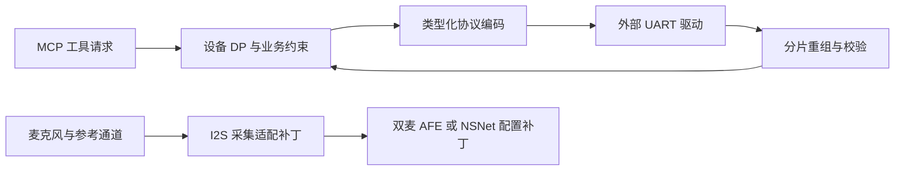

# ESP32-S3 多麦语音与智能家电核心模块

**展示重点：家电串口协议与工具调用的落地，以及多麦音频前端的实际适配改动。**

仓库包含饮水机、制冰机的协议/DP/工具适配和产测模块。涉及小智原有音频框架的修改以差异补丁发布，便于直接查看新增和修改部分。



## 推荐阅读顺序

| 代码 | 技术内容 |
| --- | --- |
| [mcu_protocol.cc](src/protocol/mcu_protocol.cc) / [协议定义](src/protocol/mcu_protocol.h) | 任意串口分片、粘包、头重同步、长度上限、校验、TLV、大端 value 与发送长度检查 |
| [饮水机 DP](integration/water_dispenser/mcu_dp.cc) / [工具映射](integration/water_dispenser/mcp_tools.cc) | 将温度、水量、童锁、故障等设备字段接入上层工具 |
| [制冰机协议](integration/ice_maker/mcu_protocol.cc) / [DP](integration/ice_maker/mcu_dp.cc) / [工具映射](integration/ice_maker/mcp_tools.cc) | 另一种家电的业务适配，用于比较协议层与产品层的分工 |
| [产测](integration/factory/potek_factory_test.cc) | 麦克风、按键、Wi-Fi、结果持久化与测试任务清理 |
| [音频补丁](patches/README.md) | RMNM 通道组织、参考输入与增益、双麦 SE/BSS、唤醒整合、PSRAM 栈与播放任务代次隔离；另一个版本的 NSNet 配置/打包 |

## 版本关系

- `v2.2.3` 补丁组：来自双麦应用快照，7 个补丁，包含需要一起阅读的头文件改动。
- `v2.5.0` 补丁组：来自另一应用快照，2 个补丁，展示 NSNet 选择和资源打包。
- 饮水机、制冰机与产测文件来自不同产品分支。这里按模块集中展示；两个音频补丁组分别面向自己的基线版本。

小智的通用会话、基础音频引擎、Opus 算法和 ESP-SR 算法仍属于上游依赖。这里能直接审阅的是协议适配、板级音频配置和任务协作改动。主机测试针对真实协议解析器，未测声学效果。

## 本地验证

安装 Python 3 和 GCC/G++ 后，在仓库根目录运行：

```sh
python tests/run_host_tests.py
```

编译器不在 PATH 时可传 `--cc /path/to/gcc`、`--cxx /path/to/g++`。测试直接编译本仓库的业务源码；`tests/ports/` 只模拟 UART、时钟或播放器等外部接口。构建产物进入被忽略的 `.host-build/`。详细覆盖与边界见 [VERIFICATION.md](VERIFICATION.md)。

## 源码与依赖

这是从实际项目提取的核心模块，用于简历展示和代码评审。`src/`、`integration/` 中的文件有原始文件哈希与发布文件哈希，见 [SOURCE_MANIFEST.json](SOURCE_MANIFEST.json)。代码保留既有命名，README 使用通用业务名称；客户品牌文字已做替换，未携带运行账号、生产密钥或客户资料。

完整芯片 SDK、上游小智框架、模型和媒体资源由原工程提供。本仓库不提供可直接烧录的完整固件；集成条件见 [docs/INTEGRATION.md](docs/INTEGRATION.md)。许可证与来源边界见 [NOTICE.md](NOTICE.md)。
